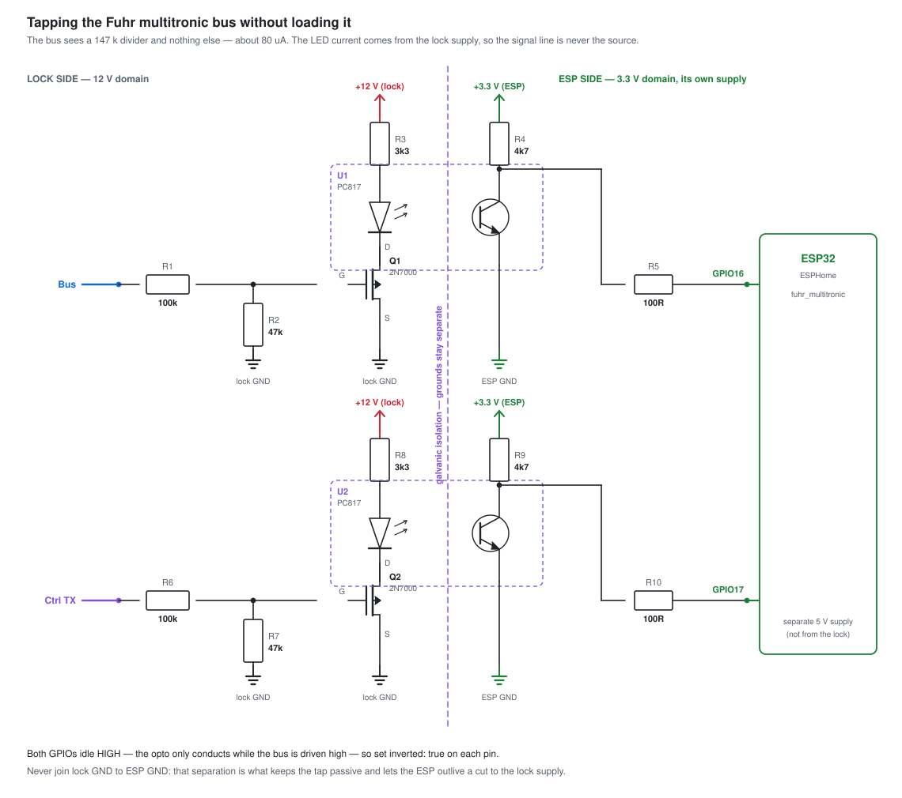
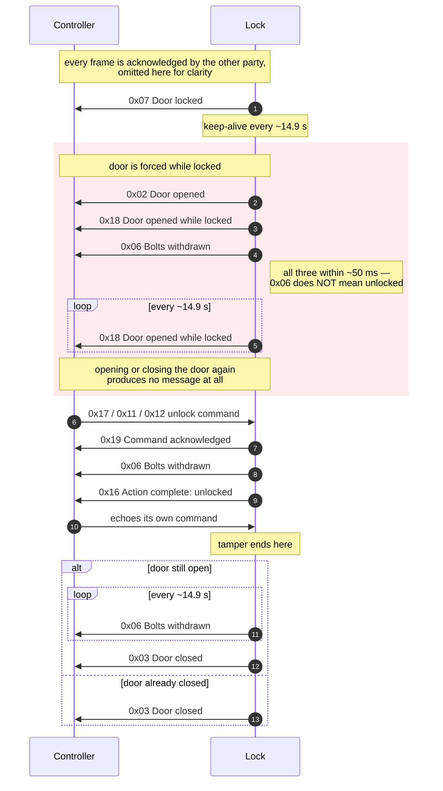

# esphome-fuhr-multitronic

ESPHome component that listens on the bus between a **Fuhr multitronic**
electronic multi-point lock and its controller, decodes every message, and
exposes the lock's state to Home Assistant.

The component is **receive only**. It never drives the bus, so it cannot
disturb the controller or the lock.

The protocol is not published by the manufacturer. It was reverse engineered
from 30 logic-analyser captures of a working installation; the full
description is in [Protocol](#protocol) below.

## Why this exists

The Fuhr controller can be driven from home automation — a relay across the
right terminals unlocks the door — and it is not completely silent in return.
It has two outputs. Neither of them, though, tells you what a home automation
or alarm system actually wants to know.

| Terminals | Fuhr's description | What it gives you |
|---|---|---|
| 3 + 4 | Swing door drive, **make contact** | A one-second pulse once the lock has opened, meant to start a door operator. A trigger, not a status. (With the DRT jumper removed it instead follows the continuous signal on 9 + 10.) |
| 5 + 6 | Alarm output, **break contact**, "output door leaf position" | A single bit that is only *secure* when the door leaf is closed **and** the lock is locked. Opening the door or unlocking the lock breaks it within a second. |

Three things the lock knows and says on the bus never make it out through those
two contacts:

* **Whether a command actually worked.** Switch the relay and you know the
  controller was asked to unlock. If the lock jams, terminals 5 + 6 stay exactly
  as they were — indistinguishable from never having asked. The lock reports it
  (`0x0D` when blocked, `0x16` when the action completed); nothing carries it
  out of the controller.
* **Whether the door was forced.** Forcing a locked door does break contact
  5 + 6 — but so does a perfectly normal unlock. One bit cannot tell an intruder
  from the postman. The lock distinguishes them clearly: `0x18` versus `0x16`.
* **Door position on its own.** 5 + 6 conflates door leaf and lock state, so
  *not secure* might mean an open door, an unlocked lock, or both. To get door
  state by itself you fit a second door contact — even though the lock is
  already announcing it several times a minute as `0x02` and `0x03`.

That is the gap this component fills. It listens on the bus between the lock and
the controller and turns what is already being said there into separate Home
Assistant entities: door position, lock state, day latch function, faults and a tamper
alarm that is actually distinguishable from a normal opening.

It stays out of the way while doing it: the component only receives, and never
drives the bus.

> Terminal descriptions quoted from the FUHR multitronic 881 manual, chapter
> 6.1. Terminal numbering may differ on other controller variants — check your
> own wiring diagram.

---

## Contents

- [Why this exists](#why-this-exists)
- [Entities](#entities)
- [Wiring](#wiring)
  - [Interface circuit](#interface-circuit)
- [Installation](#installation)
- [Configuration](#configuration)
- [Supervision](#supervision-alarming-when-the-lock-goes-quiet)
- [Protocol](#protocol)
  - [Physical layer](#physical-layer)
  - [Frame format](#frame-format)
  - [Manchester coding](#manchester-coding)
  - [Checksum](#checksum)
  - [Acknowledge frames](#acknowledge-frames)
  - [Worked example](#worked-example)
- [Communication](#communication)
  - [Message codes](#message-codes)
  - [Command handshake](#command-handshake)
  - [Keep-alive and timeout](#keep-alive-and-timeout)
  - [Typical sequences](#typical-sequences)
  - [The tamper state](#the-tamper-state-ends-only-on-an-unlock-command)
  - [Permanent open and day latch functions](#permanent-open-and-day-latch-functions)
- [Terminology](#terminology)
- [How the states are derived](#how-the-states-are-derived)
- [Caveats and open questions](#caveats-and-open-questions)
- [Tests](#tests)
- [Implementation notes](#implementation-notes)

---

## Entities

| Entity | Type | Values |
|---|---|---|
| `message` | text_sensor | every decoded frame, e.g. `LOCK 0x03 Door closed` or `CTRL 0x17 Cmd: day latch function on` |
| `door` | text_sensor | `Open` · `Closed` · `Unknown` |
| `lock` | text_sensor | `Locked` · `Unlocked` · `Locking` · `Unknown` |
| `day_latch` | text_sensor | `Off` · `On, latch withdrawn` · `On, latch out` · `Unknown` |
| `connected` | binary_sensor | connectivity: off when no message has arrived within `timeout` |
| `fault` | binary_sensor | problem: on at `0x0D`, off at any other message from the lock |
| `tamper` | binary_sensor | tamper: on at `0x18`, off at `0x16` — see [below](#the-tamper-state-ends-only-on-an-unlock-command) |

Everything starts unknown after a reboot and fills in as messages arrive. The
lock repeats its status every ~15 s, so `lock` and `fault` are correct within
about 15 seconds of boot. `door` and `day_latch` can take longer: if the lock is
sitting in a repeated `0x06`, neither the door position nor the day latch state can be
read from it, and the component does not guess. See
[Caveats](#caveats-and-open-questions).

## Wiring

The bus is a **single open-collector wire**. It rests high at roughly 11 V,
pulled up through 22 kΩ inside the controller, and either party transmits by
pulling it low. That is not a guess: it is what the original controller's own
schematic shows, and it settles the polarity question the captures alone could
not answer — see [Physical layer](#physical-layer).

Because there is only one wire, there is only one thing to tap. The separate
controller-TX signal that appears in the captures is the PIC's own transmit
pin, which exists only inside the controller; it is not available at a
terminal. Direction is recovered from the message code instead, which works
just as well and is covered by the test suite.

| Signal | Required | Notes |
|---|---|---|
| Bus | yes | the single data wire, plus the lock's ground as reference |
| Controller TX | no | only reachable inside the controller, at the PIC's transmit pin. Skip it |

### Interface circuit



This is **the receive stage of the original Fuhr controller, copied component
for component** — same topology, same values. Borrowing the manufacturer's own
input stage is the shortest route to something that provably does not disturb
the bus, because it is already sitting on it.

| Ref | Part | Value | Purpose |
|---|---|---|---|
| R1 | resistor | 220 kΩ | bus into the base; sets the load |
| R2 | resistor | 47 kΩ | base to ground, defines the threshold |
| R3 | resistor | 10 kΩ | collector pull-up to 3.3 V |
| R4 | resistor | 100 Ω | series protection into the GPIO |
| Q1 | NPN transistor | BC847B | the level shift and inversion |

Three things fall out of it, all of them improvements on an opto-coupler:

* **The bus only ever drives a base.** About 50 µA through R1 — the base clamps
  at ~0.7 V, so the load is set by the 220 kΩ, not by the divider ratio.
* **No LED, so nothing to leave lit.** An opto sitting on an idle-high line
  conducts continuously: wasted current, the CTR ageing for nothing, and the
  slow turn-off edge landing on the start bit, which is the edge the decoder
  synchronises on. None of that applies here.
* **No 12 V rail needed.** The stage runs entirely off the ESP's own 3.3 V.
  The only wires to the lock are the data line and ground.

**Set `inverted: false`.** The transistor inverts, so the GPIO sees exactly
what the PIC sees: idle low, start bit high — which is what the component
expects natively, and what every capture in this repository recorded.

```yaml
bus_pin:
  number: GPIO16
  mode: {input: true}
  inverted: false
```

**What you give up is isolation.** The ESP's ground has to be tied to the
lock's, as the original controller's is. Keep the ESP on its own 5 V supply
anyway: then cutting the lock's power still leaves the ESP alive to notice the
silence — see [Supervision](#supervision-alarming-when-the-lock-goes-quiet).
A cut data wire is equally visible: the base sees nothing, Q1 stays off, the
GPIO sits high and no frame ever decodes, so the timeout fires.

**Speed is not a concern.** The original drives a PIC interrupt pin through
this same stage at the same bit rate. A 1 nF capacitor across the bus in the
controller already rounds the edges to a ~22 µs time constant against a 500 µs
bit; do not add another one at your tap.

`docs/make_wiring.py` regenerates the diagram.

> If you do need galvanic isolation, put an opto-coupler after Q1 rather than
> in place of it — drive its LED from the collector so it only lights during
> frames. Isolating the bus side directly means an LED sitting on an idle-high
> line, which is the arrangement this circuit exists to avoid.

## Installation

```yaml
external_components:
  - source: github://arnemauer/esphome-fuhr-multitronic
    components: [fuhr_multitronic]
```

Or clone the repository and use `type: local` with `path: components`, as in
[`fuhr_lock.yaml`](fuhr_lock.yaml).

## Configuration

```yaml
fuhr_multitronic:
  id: lock_bus
  bus_pin:
    number: GPIO16
    mode: {input: true}
    inverted: false         # with the circuit above; see Interface circuit
  baud_rate: 2000           # optional
  timeout: 30s              # optional, drives the `connected` sensor
  publish_acks: false       # optional, acknowledges double the message rate

text_sensor:
  - platform: fuhr_multitronic
    fuhr_multitronic_id: lock_bus
    message: {name: "Lock last message"}
    door: {name: "Door status"}
    lock: {name: "Lock status"}
    day_latch: {name: "Day latch function"}

binary_sensor:
  - platform: fuhr_multitronic
    fuhr_multitronic_id: lock_bus
    connected: {name: "Lock connection"}
    fault: {name: "Lock fault"}
    tamper: {name: "Lock tamper alarm"}
```

### `on_message` trigger

```yaml
fuhr_multitronic:
  id: lock_bus
  bus_pin: {number: GPIO16, mode: {input: true}}
  on_message:
    - lambda: |-
        // code: uint8_t, name: std::string, from_controller: bool
        if (code == 0x18) ESP_LOGW("lock", "Tamper alarm!");
```

[`fuhr_lock.yaml`](fuhr_lock.yaml) is a complete working configuration. It also
adds template binary sensors that mirror `door` and `lock` with the matching
Home Assistant device classes; `fault` and `tamper` are already binary.

---

## Supervision: alarming when the lock goes quiet

The lock repeats its status every ~14.9 s, which makes silence itself a signal.
Cut the wire between the lock and the controller, or switch the lock off, and
the bus simply stops. That is worth alarming on: it is what a burglar disabling
the system looks like from here.

Set `timeout` to **45 s** — three missed keep-alives. Long enough not to fire on
a single corrupted frame, short enough to be useful, and still faster than the
controller itself, which needs 21 s before it flags "door not locked".

```yaml
fuhr_multitronic:
  id: lock_bus
  bus_pin: {number: GPIO16, mode: {input: true}}
  timeout: 45s                    # three missed keep-alives

binary_sensor:
  - platform: fuhr_multitronic
    fuhr_multitronic_id: lock_bus
    connected:
      name: "Lock connection"
      id: lock_connection
      on_release:                 # off = nothing heard within the timeout
        - logger.log:
            level: WARN
            format: "No status from the lock for 45 s"
```

### The ESP cannot report its own death

`connected` covers the bus going quiet. It cannot cover the ESP going quiet —
cut its power instead of the bus and no "lost contact" message is ever sent,
because there is nothing left to send it. Home Assistant has to close that gap
by treating **`unavailable` as an alarm too**:

```yaml
automation:
  - alias: "Front door lock supervision"
    mode: single
    trigger:
      # The bus went quiet but the ESP is still alive and told us.
      - platform: state
        entity_id: binary_sensor.lock_connection
        to: "off"
        id: bus_silent
      # The ESP itself stopped answering. The delay keeps OTA updates and
      # reboots from setting it off.
      - platform: state
        entity_id: binary_sensor.lock_connection
        to: "unavailable"
        for: "00:01:00"
        id: esp_silent
    action:
      - service: notify.mobile_app_phone
        data:
          title: "Front door lock"
          message: >-
            {{ "No status from the lock for 45 s"
               if trigger.id == "bus_silent"
               else "The lock monitor itself is unreachable" }}
```

Both triggers matter, and neither replaces the other: the first catches a cut
bus wire, the second catches a cut power lead, a dead ESP or a Wi-Fi failure.

### Do not power the ESP from the lock

If the ESP shares a supply with the lock, one cut kills both — and then only the
second trigger above ever fires, a minute late, with no idea why. A separate
supply, ideally with a small UPS or battery, is what turns *"I can see the lock
go quiet"* into *"I can see anything at all"*.

### Testing it

The capture `controller_loses_contact_sets_door_contact_open` contains a real
**91-second gap** between two status messages (33.7 s → 124.8 s), which is
exactly this scenario recorded live. It is in `tests/edges/`, so you can replay
it on the bench and watch `connected` drop and come back.

---

# Protocol

Everything below was derived from 30 logic-analyser captures totalling
**330 data frames**, all of which decode cleanly and pass the checksum.

## Physical layer

| | |
|---|---|
| Bit rate | **2000 baud** (500 µs per bit) |
| Topology (bus) | open collector: pulled up through 22 kΩ to ~11 V, either party transmits by pulling low |
| Idle level (bus) | **high** |
| Measured at | the controller's **PIC input**, one inverting stage further on, where idle reads low |
| Polarity (as captured) | inverted UART — a high is a logical 0 |
| Direction | inside the controller a second node carries the PIC's own transmit drive: active only during controller frames, and following the data within them. Its state at the start bit tells who is talking. Not available at a terminal |

> **Two polarities, one signal.** Every capture in this repository was taken
> at the controller's PIC input, which sits behind a 220 k/47 k divider into
> the base of a BC847B — an inverting common-emitter stage. So the bus itself
> idles **high** and is pulled **low** to send, while the captured signal idles
> **low** with a **high** start bit. The frame descriptions below are in terms
> of the captured signal.
>
> This was settled by reading the original controller's schematic, not guessed:
> the same stage also shows a 22 kΩ pull-up to 12 V through two diodes and an
> NPN pulling the line down through 100 Ω, which is an open-collector bus and
> explains how both parties share one wire.
>
> Nothing else in the protocol depends on it. Bit rate, framing, Manchester
> coding, the CRC and every message code are relative to whatever the signal
> does, so they hold at either point. The [interface
> circuit](#interface-circuit) copies that same inverting stage, so the ESP
> sees precisely what the PIC sees.

## Frame format

A data frame is 34 bit times, 17.0 ms in total:

```
      ┌───────┬────────────────────────────────────────────┬──────┐
idle  │ start │            32 line bits                    │ stop │  idle
──────┘       │                                            │      └───────
              └────────────────────┬───────────────────────┘
                                   │ Manchester decode
                                   ▼
                        ┌───────────────┬───────────────┐
                        │  bits 15..8   │   bits 7..0   │   16 payload bits
                        │ message code  │     CRC-8     │
                        └───────────────┴───────────────┘
```

The start bit is a logical 0 (line driven high), the stop bit a logical 1
(line idle). Data is transmitted **MSB first**.

## Manchester coding

Each payload bit is sent as two line bits:

| Payload bit | Line bits |
|---|---|
| `1` | `10` |
| `0` | `01` |

So the 32 "data bits" visible on a logic analyser carry only **16 bits of
information**. A useful tell: every hex nibble of a valid frame is `5`, `6`,
`9` or `A` — those are the only nibbles made of `01`/`10` pairs. Anything else
is a decoding error.

Because only the low 5 bits of the message code are ever used, the real
information content of a frame is 5 bits of message plus 8 bits of checksum.

## Checksum

**CRC-8, polynomial `0x1D`, init `0x00`, no reflection, no final XOR**,
computed over the single message byte:

```c
uint8_t crc8(uint8_t byte) {
  uint8_t crc = byte;
  for (uint8_t i = 0; i < 8; i++)
    crc = (crc & 0x80) ? ((crc << 1) ^ 0x1D) : (crc << 1);
  return crc;
}
```

`0x1D` is the classic SAE-J1850 polynomial, here with a zero init value. The
checksum is therefore purely linear, which is how it was identified:

```
c(0x01) = 0x1D   c(0x02) = 0x3A   c(0x04) = 0x74
c(0x08) = 0xE8   c(0x10) = 0xCD
```

and every observed code is the XOR of those basis values — for example
`c(0x13) = c(0x10) ^ c(0x02) ^ c(0x01) = 0xCD ^ 0x3A ^ 0x1D = 0xEA`.

## Acknowledge frames

Every data frame is answered by the **other** party with a short frame:
one start bit plus a single logical 0, then idle. No payload, no checksum.

* sent **17.4 ms** after the data frame started, i.e. right after its stop bit
* in the reference captures all 330 data frames were acknowledged; none were
  repeated or lost

An acknowledge is only ~2 bit times long, and the next data frame can follow
as little as 6 ms later, so a decoder must not assume a fixed 34 bit-time slot
per frame. (This is exactly the bug the test suite caught during development.)

## Worked example

The most common frame on the bus, `555A596A`:

```
line bits   0101 0101 0101 1010 0101 1001 0110 1010
pairs       01 01 01 01 01 01 10 10 01 01 10 01 01 10 10 10
payload      0  0  0  0  0  0  1  1  0  0  1  0  0  1  1  1   = 0x0327

code = 0x03      "Door closed"     (door closed, not locked)
crc  = 0x27      crc8(0x03) = 0x27  ✓
```

---

# Communication

## Message codes

Codes `0x00`–`0x0F` are lock status, `0x10`–`0x1F` are commands and
handshake. Direction is fixed per code.

### Controller → lock

| Code | Line bits | Meaning |
|---|---|---|
| `0x10` | `5655A5A6` | Open door / latch while the day latch function is active |
| `0x11` | `5656A655` | Day latch function **on**, latch withdrawn once — jumper TGF fitted |
| `0x12` | `5659AA6A` | Unlock door (permanent open function, ports 9 + 10) |
| `0x13` | `565AA999` | Day latch function **off** |
| `0x14` | `56659A96` | Withdraw latch / release the request input |
| `0x17` | `566A96A9` | Day latch function **on**, latch stays out — jumper TGF removed |

### Lock → controller

| Code | Line bits | Meaning |
|---|---|---|
| `0x02` | `55595A99` | Door opened |
| `0x03` | `555A596A` | Door closed, not locked |
| `0x05` | `55666996` | Locking started (motor running) |
| `0x06` | `556965A9` | Bolts withdrawn / unlocked — also a periodic status |
| `0x07` | `556A665A` | Locked and secured — also the periodic status in night mode |
| `0x08` | `5595A995` | Latch withdrawn |
| `0x0D` | `55A69556` | Fault / blocked / alarm |
| `0x0E` | `55A99969` | Locking finished, bolts thrown |
| `0x15` | `56669965` | Lock opened manually (key or handle) |
| `0x16` | `5669955A` | Action complete — lock unlocked |
| `0x18` | `56955966` | Door opened while locked — tamper alarm, persists until the lock is commanded to unlock |
| `0x19` | `56965A95` | Command acknowledged |

## Command handshake

```
CTRL  ──► command (0x10 / 0x12 / 0x17)
LOCK  ──► 0x19   command acknowledged        (+ 20 ms)
LOCK  ──► status codes while the mechanism moves
LOCK  ──► 0x16   action complete
CTRL  ──► echoes its own command             (+ 20 ms after 0x16)
```

`0x13` and `0x14` never receive a `0x19`. They behave as "off / release"
commands: after `0x13` the lock either relocks (`0x05` → `0x0E` → `0x07`) or
reports `0x0D` if it is blocked.

Note that `0x19` (command acknowledged) is a normal data frame and is itself
acknowledged by a short ACK frame — the two mechanisms are separate layers.

## Keep-alive and timeout

The lock repeats its current status code every **14.88 s** (measured across 49
intervals, spread 14.82–14.93 s). The controller falls back to a
"door not locked" fault within **21 s** of the last status — roughly one and a
half missed keep-alives. The component's `timeout` option (default 30 s)
drives the `connected` binary sensor on the same principle.

**It repeats whatever its current condition is**, so the code you see depends
on the state, not on some fixed heartbeat message. Across the 30 captures these
codes turn up as the repeated status:

| Code | Repeated while | Seen in |
|---|---|---|
| `0x07` Door locked | closed and locked — the normal resting state | 16 intervals |
| `0x03` Door closed | day latch function, after the door has been opened and closed at least once, so the latch is out again | 21 intervals |
| `0x06` Bolts withdrawn | the bolts are held withdrawn and the latch has not re-engaged: permanent open function, or day latch function before the door is first cycled | 13 intervals |
| `0x0D` Fault / alarm | blocked or faulted | 5 intervals |
| `0x18` Door opened while locked | a tamper is active | 5 intervals |

`0x06` is worth singling out twice over.

First, it is easy to assume it is only ever a transient step in an unlock
sequence. It is not: switch the day latch function on and leave the door alone,
and `0x06` is
all the lock says, every ~14.9 s, indefinitely. That is why the component may
not simply ignore it — see [the tamper section](#what-the-component-does-with-it).

Second, **`0x06` says nothing about the door**. The same repeated code occurs
with the door closed and with the door open:

```
door closed   0x07 → C 0x12 → 0x19 → 0x06 → 0x08 → 0x16 → 0x06 0x06 0x06 → C 0x14 → 0x05 …
              (permanent open, door never touched: it was locked, so closed)

door open     … 0x18 0x18 → C 0x17 → 0x19 → 0x06 → 0x16 → 0x06 0x06 … → 0x03
              (after a tamper, unlocked with the door standing open;
               0x03 only arrives when the door is actually shut)
```

So a lone `0x06` cannot be turned into a door position, and the component does
not try: it leaves `door` alone. See
[Caveats](#caveats-and-open-questions) for what that means after a reboot.

## Typical sequences

**Unlock, open the door, close it, automatic relock.** Timings are from a real
capture; the controller held the request input for 1.0 s.

```
 5.275 s  CTRL → 0x12  Cmd: unlock
 5.299 s  LOCK → 0x19  Command acknowledged
 5.352 s  LOCK → 0x06  Bolts withdrawn
 6.273 s  CTRL → 0x14  Cmd: withdraw latch        ← input released after 1.0 s
 6.367 s  LOCK → 0x08  Latch withdrawn
 9.089 s  LOCK → 0x02  Door opened
 9.112 s  LOCK → 0x16  Action complete: unlocked
 9.136 s  CTRL → 0x14  (echo)
14.767 s  LOCK → 0x03  Door closed
18.526 s  LOCK → 0x05  Locking started            ← 3.8 s after the door closed
20.849 s  LOCK → 0x0E  Locking finished           ← 2.3 s motor run
20.873 s  LOCK → 0x07  Door locked
```

Two timings are strikingly consistent across every capture: the motor takes
**2.21–2.32 s** from `0x05` to `0x0E`, and `0x0E` is followed by `0x07` within
20 ms. A closed door waits about **3.8 s** before locking starts.

**Switching the day latch function on:**

```
7.567 s  CTRL → 0x17  Cmd: day latch function on
7.591 s  LOCK → 0x19  Command acknowledged
7.644 s  LOCK → 0x06  Bolts withdrawn
9.204 s  LOCK → 0x16  Action complete: unlocked
9.227 s  CTRL → 0x17  (echo)
   ...   LOCK → 0x06  repeated every ~14.9 s
```

### The tamper state ends only on an unlock command

**Forcing the door while it is locked** — the lock reports the tamper and then
holds `0x18` as its status, replacing the normal keep-alive:

```
 8.538 s  LOCK → 0x07  Door locked
 8.968 s  LOCK → 0x02  Door opened
 8.992 s  LOCK → 0x18  Door opened while locked
 9.015 s  LOCK → 0x06  Bolts withdrawn
23.965 s  LOCK → 0x18  ← keep-alive, and every ~14.9 s after that
38.894 s  LOCK → 0x18
53.823 s  LOCK → 0x18
```

Three things about this state are worth knowing, because together they decide
how the component reads it:

* **It persists until the lock is commanded to unlock.** Closing the door does
  not end it, and neither does opening it again — no further door movement is
  reported at all. The only thing on the bus is `0x18`, repeated every ~14.9 s.
* **`0x02` and `0x06` arrive with it, and neither means what it usually means.**
  The full burst is `0x02` → `0x18` → `0x06` within ~50 ms. That `0x06` is the
  lock reporting that its bolts no longer engage anything, not that it has
  unlocked — the door was forced, the lock is still locked.
* **After the unlock, the door is reported differently.** For as long as the
  door is still open the keep-alive is `0x06`, *not* `0x02`. Only once the door
  is actually closed does `0x03` follow. If the door was already closed when the
  unlock command arrived, `0x03` comes straight after.



### What the component does with it

* `tamper` goes on at `0x18` and off at `0x16`.
* **`0x06` does not unlock the lock while a tamper is active.** It cannot simply
  be ignored either: while the bolts are held retracted and the latch has not
  re-engaged, `0x06` is the repeated status and nothing else is sent at all, so
  it would be the only thing telling the component the lock is unlocked after a
  reboot. See [keep-alive](#keep-alive-and-timeout). It is therefore gated on
  the tamper rather than dropped.
* **`0x18` sets the lock state to locked.** The message is proof of it — that is
  what makes it a tamper — which also settles the state after a reboot that
  lands in the middle of one.
* `0x02` does not unlock the lock either. A door can be opened while locked;
  that is exactly what this section is about.

The practical consequence for automations: treat `tamper` as a latched alarm,
not as a live door signal. While it lasts, `door` keeps the value it had at
`0x18`, which is `Open`, and the bus will not correct it. If you need to know
whether the door is really shut during a tamper, this bus cannot tell you — a
separate door contact can.

## Permanent open and day latch functions

What the mechanism does, as specified by the manufacturer:

| Function | Bolts | Latch |
|---|---|---|
| **Standard opening** | Opening and locking after 3 seconds | Upon opening the door leaf or after 3 seconds, the latch protrudes |
| **Permanent open function** | Remain withdrawn as long as the continuous signal is applied | Remains withdrawn as long as the continuous signal is applied |
| **Day latch function 1** | Remain withdrawn as long as the continuous signal is applied | Upon opening the door leaf or after 5 seconds, the latch protrudes |
| **Day latch function 2** | Remain withdrawn as long as the continuous signal is applied | **Not** withdrawn |

The two day latch variants are selected with the TGF jumper, and the captures
show the controller sending a **different command code** for each: function 1
is `0x11`, function 2 is `0x17`.

What that looks like on the bus:

| Function | Terminals | Activate | Release | Latch |
|---|---|---|---|---|
| **Permanent open function**, continuous | 9 + 10 | `0x12` | `0x14` | withdrawn and **stays** withdrawn |
| Ports 9 + 10 while the day latch function is active | 9 + 10 | `0x10` | — | the documented "afterwards the latch can be operated via ports 9 + 10" |
| **Day latch function 2**, jumper TGF **removed** | 11 + 12 | `0x17` | `0x13` | not withdrawn — no `0x08` at all |
| **Day latch function 1**, jumper TGF **fitted** | 11 + 12 | `0x11` | `0x13` | withdrawn **once**, then protrudes again |

The jumper does not just change the lock's behaviour — the controller sends a
different command code for it. `0x11` and `0x17` are otherwise interchangeable:
both switch the day latch function on, both are released with `0x13`.

Ports 7 + 8 were not captured. According to the manufacturer's documentation
they offer the same two functions; ports 11 + 12 with TGF fitted behave the
same way (latch back out after ~5 s).

**Function 1 (pulse ≤ 1 s) and function 2 (continuous) use the same command
code.** The difference is only how long the input is held, visible as the gap
before the matching release:

```
1 s pulse       13.93 s C 0x12  →  14.94 s C 0x14   (+1.00 s)
continuous       4.53 s C 0x12  →  67.01 s C 0x14   (+62 s)
```

### The day latch function with and without the TGF jumper

The two variants are byte-for-byte identical apart from the command code and
the latch handling:

```
TGF removed                          TGF fitted
 9.262 s  CTRL → 0x17                 9.166 s  CTRL → 0x11
 9.286 s  LOCK → 0x19                 9.190 s  LOCK → 0x19
 9.339 s  LOCK → 0x06                 9.244 s  LOCK → 0x06
                                     10.257 s  LOCK → 0x08   ← latch withdrawn
10.888 s  LOCK → 0x16                17.773 s  LOCK → 0x16
10.912 s  CTRL → 0x17  (echo)        17.797 s  CTRL → 0x11  (echo)
   ...    LOCK → 0x06 every ~14.9 s      ...   LOCK → 0x06 every ~14.9 s
31.451 s  CTRL → 0x13                38.246 s  CTRL → 0x13
35.842 s  LOCK → 0x05                42.038 s  LOCK → 0x05
38.060 s  LOCK → 0x0E                44.256 s  LOCK → 0x0E
38.084 s  LOCK → 0x07                44.280 s  LOCK → 0x07
```

Note that `0x16` arrives 1.55 s after `0x06` without the jumper, but 7.5 s
after `0x08` with it. **The latch coming back out is not reported separately**
— `0x16` is the only marker for the end of that window. The permanent open
function (`0x12`) shows exactly the same `0x08` → 7.5 s → `0x16` pattern, even
though there the latch stays withdrawn, so the timing alone does not
distinguish the two; the activating command does.

---

## Terminology

Everything in this repository is in English. The manufacturer's documentation
and the original capture filenames are Dutch, so here is the mapping:

| Dutch | English |
|---|---|
| slot | lock |
| deur | door |
| dagstand | day latch function |
| dagschoot | latch |
| nachtschoot | night bolt (the deadbolt) |
| haakschoot | hook bolt |
| schoten | bolts |
| ingetrokken | retracted |
| vergrendeld / ontgrendeld | locked / unlocked |
| storing | fault |
| loopfunctie 9 + 10 | permanent open function |
| loopfunctie 11 + 12 / dagstand | day latch function |
| openingspuls | opening pulse |

---

## How the states are derived

| Code | Meaning | Effect |
|---|---|---|
| `0x02` | Door opened | door = Open, latch out. Does **not** unlock: a door can be opened while locked |
| `0x03` | Door closed | door = Closed, lock = Unlocked, latch out |
| `0x05` | Locking started | lock = Locking |
| `0x06` | Bolts withdrawn | lock = Unlocked, **unless a tamper is active** |
| `0x07` | Door locked | door = Closed, lock = Locked, day latch off |
| `0x08` | Latch withdrawn | latch withdrawn |
| `0x0D` | Fault / alarm | fault = on |
| `0x0E` | Locking finished | lock = Locked, day latch off |
| `0x11` | Cmd day latch function on (TGF) | day latch on |
| `0x13` | Cmd day latch function off | day latch off |
| `0x15` | Manually unlocked | lock = Unlocked |
| `0x16` | Action complete: unlocked | lock = Unlocked, tamper = off; latch back out if the last command was `0x11` |
| `0x17` | Cmd day latch function on | day latch on |
| `0x18` | Door opened while locked | door = Open, lock = Locked, tamper = on |
| `0x10` `0x12` `0x14` `0x19` | — | no state change on their own |

`fault` follows a rule rather than a table row: **any** message the lock sends
other than `0x0D` clears it. That is also what lifts it out of unknown shortly
after boot, since the lock repeats its status every ~15 s. Controller commands
never resolve it — the controller has no idea whether the lock is blocked.

Frames that fail the CRC never update the state. They are logged as a warning
and published to `message` as `ERROR 0x..`.

## Caveats and open questions

* **`day_latch` starts as `Unknown`.** The day latch function is tracked from the `0x17`
  (on) and `0x13` (off) commands, plus `0x07`/`0x0E` which imply it is off. It
  is deliberately *not* inferred from `0x06`: that status also appears for the
  permanent open function (all bolts withdrawn), which is a different thing.
  Guessing there would silently report the day latch function when the door is
  merely being held open.
* **Ports 7 + 8 were never captured.** The installation these captures come
  from does not use them. Per the manufacturer's documentation they offer the
  same two functions as ports 9 + 10, and ports 11 + 12 with TGF fitted behave
  identically (latch back out after ~5 s), so `0x11` is likely what 7 + 8
  produces too — but that is inference, not measurement.
* **The latch coming back out is not announced.** With `0x11` the component
  reports *On, latch withdrawn* between `0x08` and `0x16`,
  then *On, latch out*. That matches the observed ~5 s behaviour closely but is
  derived from `0x16`, not from a dedicated message.
* **After a reboot into a steady `0x06`, the door state stays unknown.** `0x06`
  is sent both with the door closed (permanent open function, or the day latch
  function nobody has used yet) and with the door open (after a tamper, once the lock is
  unlocked). Nothing in the message distinguishes them, and after a reboot
  there is no history to fall back on either. `door` therefore stays `Unknown`
  until something conclusive arrives — `0x02`/`0x18` for open, `0x03`/`0x07`
  for closed — which in practice means until somebody uses the door. It is a
  deliberate choice: a guess here would be wrong roughly whenever it matters
  most.
* **Unknown codes are logged, not guessed.** Any code outside the table is
  published as `Unknown code` and leaves the state untouched.

## Tests

```bash
g++ -std=c++11 -O2 -Wall -Wextra -Werror -o tests/test_native tests/test_native.cpp
cd tests && ./test_native .
```

Replays all 30 captures through the real decoder, four times each: from
`t = 0` and with the clock offset so `micros()` wraps mid-capture, each with
and without the controller-TX line connected.

```
captures replayed : 30 (x2 clock bases x2 wiring modes)
data frames       : 330
acknowledges      : 330
failures          : 0
PASS
```

The raw `.sr` captures are not in this repository — the generated fixtures in
`tests/edges/` are committed instead, so the suite runs without them.
`tests/export_edges.py` regenerates the fixtures when new captures are added.

## Implementation notes

`components/fuhr_multitronic/fuhr_protocol.h` contains the entire protocol —
frame decoder, Manchester, CRC-8 and state machine — with no ESPHome
dependency, so it compiles and runs on a PC. `fuhr_multitronic.cpp` only adds
the interrupt handler, a 64-entry edge ring buffer and the entity plumbing.

Frames are segmented on **edge timestamps**, not on when the main loop happens
to run, so a loop stall of tens of milliseconds cannot corrupt a frame. Bits
are sampled at absolute offsets from the start bit rather than by accumulating
bit periods.

## Licence

MIT — see [LICENSE](LICENSE).

Fuhr and multitronic are trademarks of their respective owner. This project is
not affiliated with or endorsed by the manufacturer.
